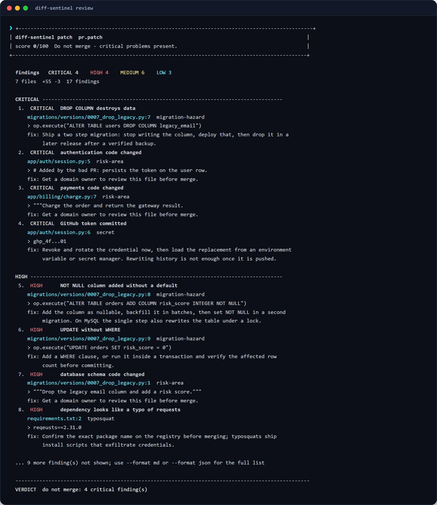
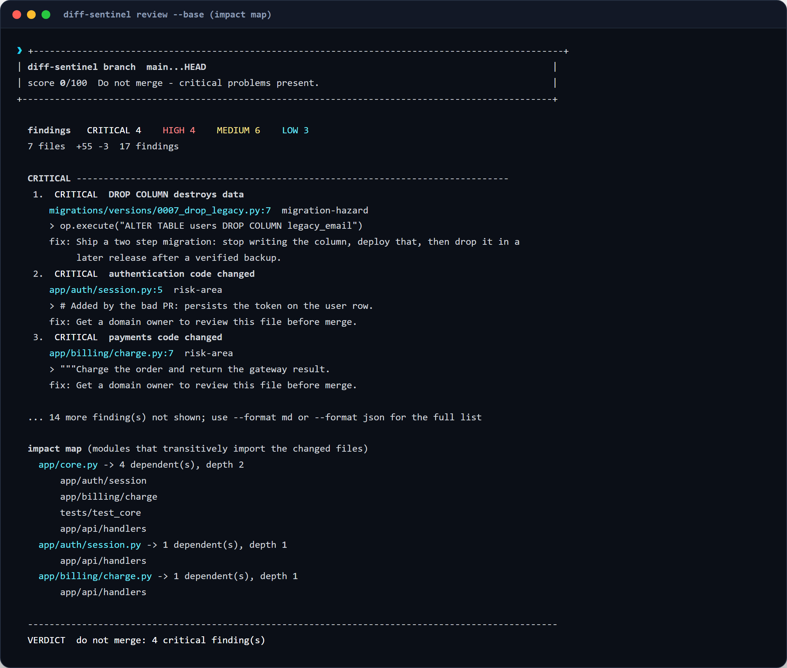
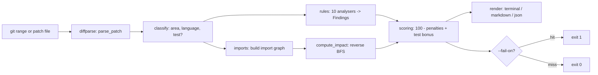

# diff-sentinel

**English** | [简体中文](README.zh-CN.md)

Review a pull request like a senior engineer, without an LLM: it reads the diff, ranks every problem by severity with a file:line and a fix, and tells you whether the change is safe to merge.

[](https://github.com/kele-tao/diff-sentinel/actions/workflows/ci.yml)




## The problem

Review attention is the scarcest resource on a team. A 400-line diff takes 45
minutes to review properly and about 4 minutes to rubber-stamp, and reviewers
default to the rubber stamp when they are tired. The problems that slip through
are boringly consistent: a credential pasted into a config file, a migration
that drops a column, an assertion deleted to make a flaky test pass, a new
dependency whose name is one keystroke away from a typosquat. None of those need
a model that has read the internet. They need a checklist that never gets tired,
runs in CI on every push, and points at the exact line.

diff-sentinel is that checklist: 19 rules, 10 analysers, 112 tests, no network, no
tokens, no training data, and a deterministic score you can gate a pipeline on.

## What it does

- **Reads the diff, not the repository.** Parses `git diff` output, `--staged`
  changes, or a `.patch` file (including renames, binary markers, quoted paths
  and CRLF patches).
- **Classifies risk by area.** Changes to `auth/`, `payments/`, `migrations/`,
  raw SQL, infrastructure, configuration and dependency manifests get an explicit
  risk finding with a severity derived from the area, not from the line count.
- **Catches missing tests.** Counts the decision points a diff adds and checks
  whether any test file was touched at all, then whether the changed module or
  function is actually named in the test changes.
- **Catches deleted assertions.** Assertions removed from a test, or a test file
  deleted outright, are how a regression gets shipped without anyone noticing.
- **Reviews migrations like a DBA.** `DROP COLUMN`, `DROP TABLE`, `TRUNCATE`,
  `ADD COLUMN ... NOT NULL` without a default, column renames, `UPDATE` without
  `WHERE`, non-concurrent index builds, and DDL with no transaction around it.
- **Audits dependency additions.** New package name, a licence guess from a
  bundled table of ~50 popular packages, a pinning check, and a Damerau-Levenshtein
  distance check that flags names one edit away from a popular package
  (`reqeusts` -> `requests`).
- **Finds credentials.** AWS keys, GitHub/GitLab/Slack tokens, Stripe keys,
  Google API keys, JWTs, private key blocks, database URLs with embedded
  passwords, and hardcoded `password = "..."` assignments. Real values are masked
  in every output format.
- **Finds debug leftovers.** `print`, `console.log`, `breakpoint()`, `pdb`,
  `debugger`, and commented-out code that should have been deleted.
- **Draws a change-impact map.** A stdlib `ast` import graph (plus a regex
  scanner for JS/TS) answers "which modules transitively import what I changed",
  so a one-line edit in `core.py` shows the four modules that break with it.
- **Scores review readiness 0-100** with a one-line verdict, and exits non-zero
  above a severity you choose (`--fail-on high`) so CI can block the merge.
- **Emits the artefacts the review needs:** a terminal card, Markdown for the PR
  comment, JSON for tooling, and a ready-to-commit GitHub Actions workflow.

## Install

diff-sentinel is pure standard library (Python 3.10+) and is not on PyPI yet.
Install from source:

```bash
git clone https://github.com/kele-tao/diff-sentinel
cd diff-sentinel
pip install -e .
diff-sentinel --version
```

For development:

```bash
pip install -e ".[dev]"   # pytest + ruff
python -m pytest -q
```

Both entry points work: `diff-sentinel ...` and `python -m diff_sentinel ...`.

## Usage

### 1. Review a patch file (the six-problem diff in `examples/pr.patch`)

```console
$ diff-sentinel review --patch examples/pr.patch
+--------------------------------------------------------------------------------------------------+
| diff-sentinel patch  pr.patch                                                                    |
| score 0/100  Do not merge - critical problems present.                                           |
+--------------------------------------------------------------------------------------------------+

  findings   CRITICAL 4    HIGH 4    MEDIUM 6    LOW 3
  7 files  +55 -3  17 findings

  CRITICAL --------------------------------------------------------------------------------
   1.  CRITICAL  DROP COLUMN destroys data
      migrations/versions/0007_drop_legacy.py:7  migration-hazard
      > op.execute("ALTER TABLE users DROP COLUMN legacy_email")
      fix: Ship a two step migration: stop writing the column, deploy that, then drop it in a
           later release after a verified backup.
   2.  CRITICAL  authentication code changed
      app/auth/session.py:5  risk-area
      > # Added by the bad PR: persists the token on the user row.
      fix: Get a domain owner to review this file before merge.
   3.  CRITICAL  payments code changed
      app/billing/charge.py:7  risk-area
      > """Charge the order and return the gateway result.
      fix: Get a domain owner to review this file before merge.
   4.  CRITICAL  GitHub token committed
      app/auth/session.py:6  secret
      > ghp_4f...01
      fix: Revoke and rotate the credential now, then load the replacement from an environment
           variable or secret manager. Rewriting history is not enough once it is pushed.

  HIGH ------------------------------------------------------------------------------------
   5.  HIGH      NOT NULL column added without a default
      migrations/versions/0007_drop_legacy.py:8  migration-hazard
      > op.execute("ALTER TABLE orders ADD COLUMN risk_score INTEGER NOT NULL")
      fix: Add the column as nullable, backfill it in batches, then set NOT NULL in a second
           migration. On MySQL the single step also rewrites the table under a lock.

  ... 12 more finding(s) not shown; use --format md or --format json for the full list

  --------------------------------------------------------------------------------------------------
  VERDICT  do not merge: 4 critical finding(s)
```

### What it caught in that diff

[`examples/pr.patch`](examples/pr.patch) is a real `git diff` (regenerated by
[`examples/make_patch.py`](examples/make_patch.py); CI asserts the committed file is byte
identical) with six problems planted in it. Here is the mapping from intent to finding, so you
can check the tool's work by reading the patch:

| planted problem | the code | diff-sentinel finding |
| --- | --- | --- |
| API token checked into source | `API_TOKEN = "ghp_4f..."` in `app/auth/session.py` | `secret` — critical, value masked as `ghp_4f...01` |
| destructive migration | `ALTER TABLE users DROP COLUMN legacy_email` | `migration-hazard` — critical, "DROP COLUMN destroys data" |
| NOT NULL column with no default | `ADD COLUMN risk_score INTEGER NOT NULL` | `migration-hazard` — high, two-step migration suggested |
| unbounded UPDATE | `UPDATE orders SET risk_score = 0` with no WHERE | `migration-hazard` — high, "UPDATE without WHERE" |
| typosquatted dependency | `reqeusts==2.31.0` next to `requests` | `typosquat` — high, edit distance 1 from `requests` |
| debug leftovers | `print(...)` and a commented-out `console.log` | `debug-leftover` — low, twice |

The other 11 findings are the context rules doing their job on the same diff: the auth and
payments risk areas, missing coverage for the two new branches, DDL with no transaction, an
unpinned `stripe` dependency, and five unrelated modules changing at once.

The full report (all 17 findings) is in [docs/sample-review.md](docs/sample-review.md); the
machine-readable version is [docs/sample-review.json](docs/sample-review.json).

### 2. Review a branch, with the change-impact map

`python examples/branch_review.py` builds a throwaway two-commit repository (from
`examples/repo` and `examples/repo-after`) and reviews the second commit against the first.
That is the run behind the screenshot below — the impact map is real transitive output of the
Python import graph, not an illustration.



```console
$ python examples/branch_review.py --plain
  impact map (modules that transitively import the changed files)
    app/core.py -> 4 dependent(s), depth 2
        app/auth/session
        app/billing/charge
        tests/test_core
        app/api/handlers
    app/auth/session.py -> 1 dependent(s), depth 1
        app/api/handlers
    app/billing/charge.py -> 1 dependent(s), depth 1
        app/api/handlers

  VERDICT  do not merge: 4 critical finding(s)
```

Against your own repository the same command is `diff-sentinel review --repo . --base
origin/main`. The range is resolved through `git merge-base`, so it works on a feature branch
and on a CI checkout of a pull request. `--staged` reviews the index instead.

Reading the map: `app/core.py` is imported by the auth, billing and api modules plus one
test, at depth 2. A one-line change there is not a one-line review, and now the reviewer knows
it before opening the file.

### 3. Gate CI on it

```console
$ diff-sentinel score --base origin/main --fail-on high
FAIL  score=0/100  findings=17  blocking=8 (>=high)  Do not merge - critical problems present.
$ echo $?
1
```

Generate the workflow file itself:

```bash
diff-sentinel review --patch pr.patch --emit-ci > .github/workflows/diff-sentinel.yml
```

### Other flags that earn their keep

| flag | why |
| --- | --- |
| `--format md` | paste the review into the PR comment; tables, no ANSI |
| `--format json` | stable schema for dashboards and gates |
| `--limit N` | print the top N findings in the terminal card |
| `--ignore PREFIX` | skip vendored or generated paths (repeatable) |
| `--max-files N` | refuse to review a diff bigger than a human can |
| `--no-tests` | disable the missing-test rules on legacy repos |
| `rules` | list every rule, its severities and what it looks for |

Exit codes are fixed: `0` review finished and nothing reached the gate, `1` the
gate failed, `2` usage error (bad flag, missing patch, unknown git ref). No raw
traceback escapes for a user mistake — every failure is one actionable sentence.

## How it works



The parser turns the unified diff into `Diff -> FileDiff -> Hunk -> (kind, text, line)`
tuples. Every added line keeps its **new-file line number**, which is what makes
`app/auth/session.py:6` in the report a real location you can click.

Path classification is a single ordered table (payments, auth, migrations, SQL,
infra, config, dependencies, docs, CI, tests) so the risk rule and the test
exemption can never disagree about what a file is.

The ten analysers are pure functions over a shared, read-only context: risk,
missing tests, deleted assertions, migration hazards, dependencies, secrets,
debug leftovers, size, unrelated changes and PR hygiene. Each returns findings;
nothing mutates anything. That makes each rule testable with a five-line patch,
which is exactly what the test suite does.

Scoring is linear and published so it cannot surprise you: start at 100, subtract
26 per critical, 11 per high, 5 per medium, 2 per low, add back 4 per changed
test file (capped at 8), clamp to 0..100. Verdicts: 90+ ready to merge, 75+ nits,
55+ needs changes, 30+ risky, below that do not merge.

The impact map rebuilds a reverse import graph of the repository with a depth
cap of 8 and at most 40 dependents per module. That bound is why a 500-file diff
still finishes in half a second.

## Design decisions

**1. Parse the diff, not the repository.** Reading only the diff means the tool
never imports or executes the code under review, so it is safe on untrusted
patches, and it stays fast on a monorepo where parsing everything would take
minutes. The cost is that rules cannot see context outside the hunk; that is why
every finding says "review this" rather than pretending to prove a bug.

**2. Findings are structured data, not formatted strings.** A `Finding` carries
rule id, severity, path, line, evidence, fix and detail as fields. All three
renderers consume that object, so `--format json` and `--format md` can never
disagree, and a CI script can gate on `severity` instead of scraping text. The
cost is a slightly larger model file and a renderer that must be written three
ways.

**3. Zero runtime dependencies.** A review tool has to run in a locked-down CI
container on day one. Everything here is `re`, `ast`, `subprocess`, `json` and
`dataclasses`. The cost is hand-written parsers for JS/TS imports and a bundled
licence table instead of a package registry API; both are documented as limits
rather than hidden.

## Performance

Measured by `python benchmarks/run.py`, which generates the repository and the
diffs, times the real code path five times per row, and writes
[benchmarks/RESULTS.md](benchmarks/RESULTS.md) and
[benchmarks/results.json](benchmarks/results.json). Nothing in the table is
typed by hand.

| files | changed lines | diff size | parse | review (parse + rules + impact) | findings |
| --- | --- | --- | --- | --- | --- |
| 50 | 300 | 18.0 KB | 1.59 ms | 240.28 ms | 101 |
| 150 | 900 | 54.1 KB | 4.76 ms | 269.40 ms | 302 |
| 500 | 3000 | 180.2 KB | 14.82 ms | 307.93 ms | 1003 |

Parsing 500 files takes 15 ms; the rest is the import graph, which is rebuilt per
run over a 600-module synthetic repo. A 500-file diff reviews in **0.31 s**,
well inside the 3 s budget. Run the benchmark yourself: `python benchmarks/run.py`.

## Comparison

| tool | what it does better | why diff-sentinel exists next to it |
| --- | --- | --- |
| [Semgrep](https://semgrep.dev) | far deeper language-aware dataflow analysis, huge rule registry, autofix | heavier to adopt, needs rule authoring for project-specific policies, no PR-level scoring or impact map |
| [gitleaks](https://github.com/gitleaks/gitleaks) | scans full git history and every blob for secrets | diff-sentinel only scans added lines; gitleaks is the right tool for "did we ever leak something" |
| [Danger JS](https://danger.systems) | arbitrary per-repo PR policy in JS | diff-sentinel ships the policy: 19 rules, no scripting, stdlib only, works offline |
| review bots (CodeRabbit, etc.) | natural-language review, whole-repo context | send your diff to a third party, non-deterministic, per-seat pricing; diff-sentinel is local, deterministic and free |

diff-sentinel is deliberately not an LLM reviewer. It does not rewrite your code,
it does not comment on naming, and it will not tell you the abstraction is wrong.
It tells you where a reviewer should look first, and it does it the same way every
time.

## Roadmap

Full detail in [docs/ROADMAP.md](docs/ROADMAP.md). Next up:

1. `.diff-sentinel.toml` for rule severity overrides and per-project ignores.
2. SARIF output so findings render inline in the GitHub files-changed tab.
3. A Go import resolver, then Rust, behind the same graph interface.
4. Golden-file tests for the terminal renderer (a real terminal snapshot).
5. Richer migration analysis: lock duration estimates per engine.

Deliberately **not** shipped, and recorded in the roadmap rather than faked:
direct GitHub comment posting, monorepo path-alias resolution, and full-history
secret scanning.

## Contributing

Issues and pull requests are welcome. A false positive is a bug: open an issue
with the five-line patch that triggered it. See [CONTRIBUTING.md](CONTRIBUTING.md)
for the test rule (every rule needs a test, a catalogue entry and a fix string)
and [SECURITY.md](SECURITY.md) for how secrets are handled in reports.

```bash
git clone https://github.com/kele-tao/diff-sentinel
cd diff-sentinel
pip install -e ".[dev]"
python -m pytest -q      # 112 tests, offline
ruff check .             # style, line length 100
python -m coverage run --source=src/diff_sentinel -m pytest -q && python -m coverage report  # 88%
```

## License

MIT (c) 2026 kele. See [LICENSE](LICENSE).