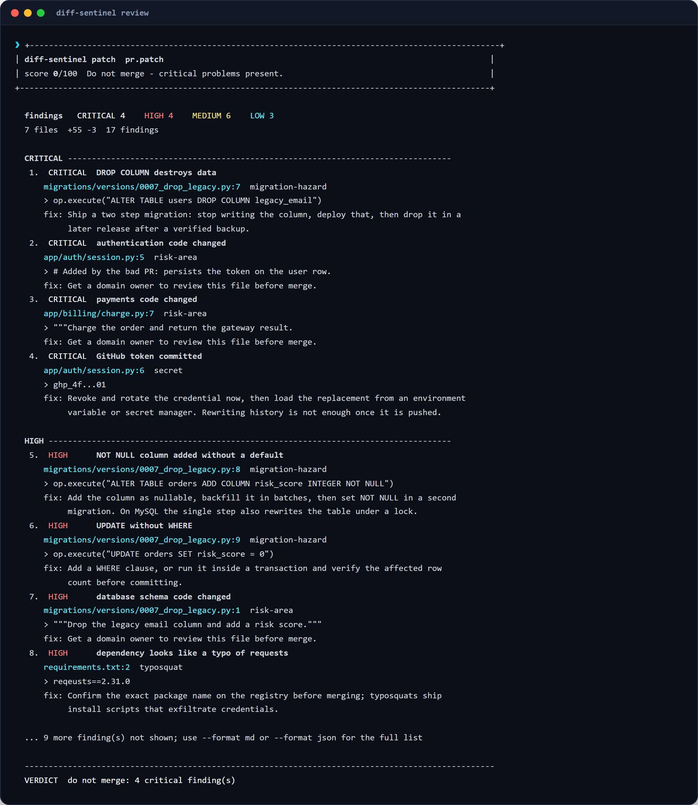
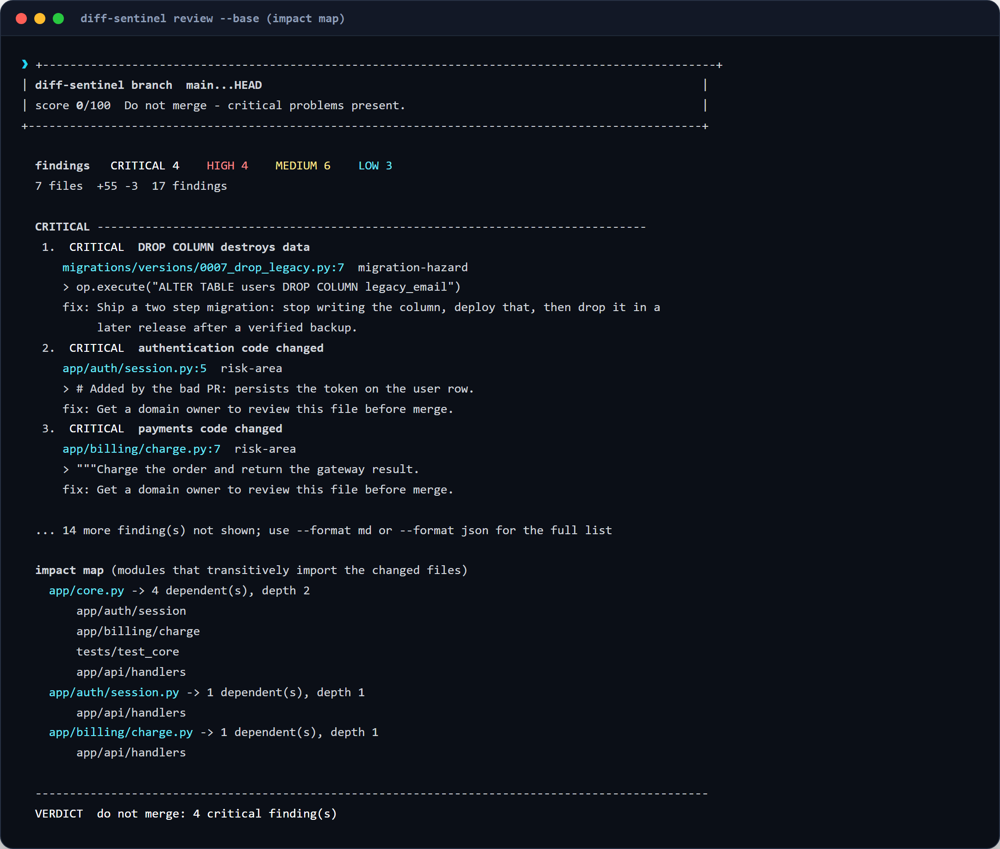
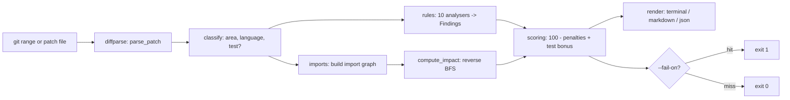

# diff-sentinel

[English](README.md) | **简体中文**

像资深工程师那样审查一个 pull request，而且不用 LLM：它读取 diff，把每个问题按严重度排序，给出 file:line 位置和修复建议，并告诉你这次改动是否可以安全合并。

[](https://github.com/kele-tao/diff-sentinel/actions/workflows/ci.yml)




## 问题

评审注意力是团队里最稀缺的资源。一个 400 行的 diff，认真审完要 45 分钟，
盖章放行大概 4 分钟，而评审者累的时候默认就是盖章放行。漏过去的问题无聊得
惊人地一致：凭据被粘进配置文件、迁移脚本删掉一列、为了让不稳定测试通过而删掉
断言、新增依赖的名字和某个仿冒包只差一次按键。这些问题都不需要一个读过整个
互联网的模型，它们需要的是一份永远不会累、每次 push 都在 CI 里跑、并且能指到
具体行号的检查清单。

diff-sentinel 就是这份清单：19 条规则、10 个分析器、112 个测试，不联网、不用
token、不需要训练数据，给出一个可以直接拿来卡流水线的确定性分数。

## 它能做什么

- **读 diff，不读整个仓库。** 解析 `git diff` 输出、`--staged` 改动，或者
  一个 `.patch` 文件（包括重命名、二进制标记、带引号的路径和 CRLF 补丁）。
- **按区域给风险分类。** 对 `auth/`、`payments/`、`migrations/`、裸 SQL、
  基础设施、配置和依赖清单的改动，会生成一条显式的风险 finding，严重度由
  区域决定，而不是由行数决定。
- **发现缺失的测试。** 统计 diff 新增了多少个判定点，检查有没有任何测试文件被
  改动过，再检查改动的模块或函数是否真的在测试改动里被提到。
- **发现被删掉的断言。** 从测试里被移除的断言，或者整个测试文件被删除，正是
  回归能在没人注意的情况下发版的路径。
- **像 DBA 一样审查迁移。** `DROP COLUMN`、`DROP TABLE`、`TRUNCATE`、
  没有默认值的 `ADD COLUMN ... NOT NULL`、列重命名、没有 `WHERE` 的
  `UPDATE`、非并发索引构建，以及没有事务包裹的 DDL。
- **审计新增依赖。** 新包名、基于约 50 个热门包的内置表所做的许可证猜测、
  版本锁定检查，以及一个 Damerau-Levenshtein 距离检查，用来标记与某个热门包
  只差一次编辑的名字（`reqeusts` -> `requests`）。
- **发现凭据。** AWS key、GitHub/GitLab/Slack token、Stripe key、Google API
  key、JWT、私钥块、内嵌密码的数据库 URL，以及硬编码的 `password = "..."`
  赋值。真实值在所有输出格式里都会被掩码。
- **发现调试残留。** `print`、`console.log`、`breakpoint()`、`pdb`、
  `debugger`，以及本该删掉却被注释掉的代码。
- **画出变更影响图。** 用标准库 `ast` 构建导入图（对 JS/TS 另加一个正则
  扫描器），回答“哪些模块会传递性地导入我改的东西”，于是一行改动落在
  `core.py` 上，会显示连带坏掉的另外四个模块。
- **给出 0-100 的评审就绪分**，附一行结论，并在超过你选定的严重度时以非零码
  退出（`--fail-on high`），让 CI 可以拦下合并。
- **输出评审需要的产物：** 终端卡片、给 PR 评论用的 Markdown、给工具链用的
  JSON，以及一个可以直接提交的 GitHub Actions workflow。

## 安装

diff-sentinel 只用标准库（Python 3.10+），目前还没有发布到 PyPI。从源码安装：

```bash
git clone https://github.com/kele-tao/diff-sentinel
cd diff-sentinel
pip install -e .
diff-sentinel --version
```

开发环境：

```bash
pip install -e ".[dev]"   # pytest + ruff
python -m pytest -q
```

两个入口都能用：`diff-sentinel ...` 和 `python -m diff_sentinel ...`。

## 用法

### 1. 审查一个补丁文件（`examples/pr.patch` 里那个埋了六个问题的 diff）

```console
$ diff-sentinel review --patch examples/pr.patch
+--------------------------------------------------------------------------------------------------+
| diff-sentinel patch  pr.patch                                                                    |
| score 0/100  Do not merge - critical problems present.                                           |
+--------------------------------------------------------------------------------------------------+

  findings   CRITICAL 4    HIGH 4    MEDIUM 6    LOW 3
  7 files  +55 -3  17 findings

  CRITICAL --------------------------------------------------------------------------------
   1.  CRITICAL  DROP COLUMN destroys data
      migrations/versions/0007_drop_legacy.py:7  migration-hazard
      > op.execute("ALTER TABLE users DROP COLUMN legacy_email")
      fix: Ship a two step migration: stop writing the column, deploy that, then drop it in a
           later release after a verified backup.
   2.  CRITICAL  authentication code changed
      app/auth/session.py:5  risk-area
      > # Added by the bad PR: persists the token on the user row.
      fix: Get a domain owner to review this file before merge.
   3.  CRITICAL  payments code changed
      app/billing/charge.py:7  risk-area
      > """Charge the order and return the gateway result.
      fix: Get a domain owner to review this file before merge.
   4.  CRITICAL  GitHub token committed
      app/auth/session.py:6  secret
      > ghp_4f...01
      fix: Revoke and rotate the credential now, then load the replacement from an environment
           variable or secret manager. Rewriting history is not enough once it is pushed.

  HIGH ------------------------------------------------------------------------------------
   5.  HIGH      NOT NULL column added without a default
      migrations/versions/0007_drop_legacy.py:8  migration-hazard
      > op.execute("ALTER TABLE orders ADD COLUMN risk_score INTEGER NOT NULL")
      fix: Add the column as nullable, backfill it in batches, then set NOT NULL in a second
           migration. On MySQL the single step also rewrites the table under a lock.

  ... 12 more finding(s) not shown; use --format md or --format json for the full list

  --------------------------------------------------------------------------------------------------
  VERDICT  do not merge: 4 critical finding(s)
```

### 它在那份 diff 里抓到了什么

`examples/pr.patch` 是一份真实的 `git diff`（由 `examples/make_patch.py`
重新生成；CI 会断言仓库里提交的那份与生成结果逐字节一致），里面埋了六个问题。
下面是“意图 → finding”的对照表，你可以对着补丁检查这个工具干得对不对：

| 埋入的问题 | 对应的代码 | diff-sentinel 的 finding |
| --- | --- | --- |
| API token 被写进源码 | `app/auth/session.py` 里的 `API_TOKEN = "ghp_4f..."` | `secret` —— critical，值被掩码为 `ghp_4f...01` |
| 破坏性迁移 | `ALTER TABLE users DROP COLUMN legacy_email` | `migration-hazard` —— critical，“DROP COLUMN destroys data” |
| 没有默认值的 NOT NULL 列 | `ADD COLUMN risk_score INTEGER NOT NULL` | `migration-hazard` —— high，建议分两步迁移 |
| 没有边界的 UPDATE | 没有 WHERE 的 `UPDATE orders SET risk_score = 0` | `migration-hazard` —— high，“UPDATE without WHERE” |
| 仿冒包依赖 | 与 `requests` 并列的 `reqeusts==2.31.0` | `typosquat` —— high，与 `requests` 的编辑距离为 1 |
| 调试残留 | `print(...)` 和一段被注释掉的 `console.log` | `debug-leftover` —— low，出现两次 |

另外 11 条 finding 是上下文规则在同一份 diff 上的正常工作：auth 和 payments
两个风险区域、两个新分支缺少覆盖率、没有事务的 DDL、未钉住版本的 `stripe`
依赖，以及五个互不相关的模块同时改动。

完整报告（全部 17 条 finding）见 [docs/sample-review.md](docs/sample-review.md)；
机器可读版本见 [docs/sample-review.json](docs/sample-review.json)。

### 2. 审查一个分支，并查看变更影响图

`python examples/branch_review.py` 会构建一个用完即弃的两提交仓库（来自
`examples/repo` 和 `examples/repo-after`），并把第二个提交相对第一个提交来
审查。这就是下面截图背后的那次运行 —— 影响图是 Python 导入图真实的传递输出，
不是画出来的示意图。



```console
$ python examples/branch_review.py --plain
  impact map (modules that transitively import the changed files)
    app/core.py -> 4 dependent(s), depth 2
        app/auth/session
        app/billing/charge
        tests/test_core
        app/api/handlers
    app/auth/session.py -> 1 dependent(s), depth 1
        app/api/handlers
    app/billing/charge.py -> 1 dependent(s), depth 1
        app/api/handlers

  VERDICT  do not merge: 4 critical finding(s)
```

在你自己的仓库上，等价的命令是 `diff-sentinel review --repo . --base
origin/main`。范围通过 `git merge-base` 解析，所以在 feature branch 上、在 CI
里 checkout 出来的 pull request 上都能用。`--staged` 则改为审查暂存区。

怎么读这张图：`app/core.py` 被 auth、billing、api 三个模块外加一个测试导入，
深度为 2。那里一行的改动并不等于一行的评审量，而现在评审者在打开文件之前就
知道了。

### 3. 用它给 CI 设卡

```console
$ diff-sentinel score --base origin/main --fail-on high
FAIL  score=0/100  findings=17  blocking=8 (>=high)  Do not merge - critical problems present.
$ echo $?
1
```

直接生成 workflow 文件本身：

```bash
diff-sentinel review --patch pr.patch --emit-ci > .github/workflows/diff-sentinel.yml
```

### 其他值得保留的 flag

| flag | 用途 |
| --- | --- |
| `--format md` | 把评审结果粘进 PR 评论；有表格，没有 ANSI |
| `--format json` | 给仪表盘和门禁用的稳定 schema |
| `--limit N` | 在终端卡片里只打印前 N 条 finding |
| `--ignore PREFIX` | 跳过 vendored 或生成出来的路径（可重复） |
| `--max-files N` | 拒绝审查超出人类可审规模的 diff |
| `--no-tests` | 在遗留仓库上关掉缺失测试的规则 |
| `rules` | 列出每条规则、它的严重度和它检查什么 |

退出码是固定的：`0` 审查完成且没有任何东西触到门禁，`1` 门禁未通过，
`2` 用法错误（flag 写错、patch 不存在、git ref 未知）。用户的操作失误不会
抛出原始 traceback —— 每个失败都是一句可以直接照做的话。

## 工作原理



解析器把 unified diff 变成 `Diff -> FileDiff -> Hunk -> (kind, text, line)`
这样的元组。每一条新增行都保留它的**新文件行号**，这正是报告里的
`app/auth/session.py:6` 是一个可以点击的真实位置的原因。

路径分类是一张有序的表（payments、auth、migrations、SQL、infra、config、
dependencies、docs、CI、tests），所以风险规则和测试豁免规则永远不会对一个
文件到底属于什么产生分歧。

十个分析器都是作用在共享只读上下文上的纯函数：风险、缺失测试、被删断言、迁移
风险、依赖、密钥、调试残留、体积、无关改动和 PR 卫生。每一个都只返回
finding，什么都不改动。这让每条规则都能用一个五行补丁来测试，而测试套件做的
正是这件事。

评分是线性的而且公开，所以不会给你惊喜：从 100 起步，每个 critical 减 26，
每个 high 减 11，每个 medium 减 5，每个 low 减 2，每个改动的测试文件加回 4
（上限 8），最后限制在 0 到 100 之间。结论：90+ 可以合并，75+ 只剩小问题，
55+ 需要修改，30+ 有风险，再低就是不要合并。

影响图用 8 的深度上限、每个模块最多 40 个依赖者，重建仓库的反向导入图。正是
这个上界让一个 500 文件的 diff 依然能在半秒内跑完。

## 设计取舍

**1. 解析 diff，而不是解析仓库。** 只读 diff 意味着工具从不导入、也不执行被
审查的代码，因此面对不可信的补丁是安全的，而且在解析整个仓库要花上几分钟的
monorepo 上依然够快。代价是规则看不到 hunk 之外的上下文；这就是为什么每条
finding 说的是“看看这里”，而不是假装证明了一个 bug。

**2. finding 是结构化数据，不是拼好的字符串。** 一个 `Finding` 以字段的形式
携带 rule id、severity、path、line、evidence、fix 和 detail。三个渲染器都
共用这个对象，所以 `--format json` 和 `--format md` 永远不会互相矛盾，CI
脚本也可以直接针对 `severity` 设卡，而不必去抓文本。代价是模型文件略大，以及
渲染器要写三遍。

**3. 零运行时依赖。** 一个审查工具必须第一天就能在封闭的 CI 容器里跑起来。
这里所有东西都来自 `re`、`ast`、`subprocess`、`json` 和 `dataclasses`。
代价是手写的 JS/TS 导入解析器，以及一张内置的许可证表而不是包注册表 API；
这两点都写进了局限里，而不是藏起来。

## 性能

由 `python benchmarks/run.py` 测量：它生成仓库和 diff，对每一行把真实代码路径
计时跑五遍，并写出 [benchmarks/RESULTS.md](benchmarks/RESULTS.md) 和
[benchmarks/results.json](benchmarks/results.json)。表里没有任何一个数字是手写的。

| 文件数 | 变更行数 | diff 大小 | 解析 | 审查（解析 + 规则 + 影响图） | findings |
| --- | --- | --- | --- | --- | --- |
| 50 | 300 | 18.0 KB | 1.59 ms | 240.28 ms | 101 |
| 150 | 900 | 54.1 KB | 4.76 ms | 269.40 ms | 302 |
| 500 | 3000 | 180.2 KB | 14.82 ms | 307.93 ms | 1003 |

解析 500 个文件花 15 ms；剩下的时间是导入图，它在每次运行时都要在一个 600 个
模块的合成仓库上重建。一个 500 文件的 diff 审完是 **0.31 s**，稳稳落在 3 s 的
预算之内。自己跑一遍基准测试：`python benchmarks/run.py`。

## 对比

| 工具 | 它做得更好的地方 | 为什么还需要 diff-sentinel |
| --- | --- | --- |
| [Semgrep](https://semgrep.dev) | 语言感知的数据流分析深得多、规则库庞大、支持自动修复 | 落地更重，项目专属策略要自己写规则，没有 PR 级评分和影响图 |
| [gitleaks](https://github.com/gitleaks/gitleaks) | 扫描完整 git 历史和每个 blob 找密钥 | diff-sentinel 只扫新增行；“我们历史上到底有没有泄露过”该用 gitleaks |
| [Danger JS](https://danger.systems) | 用 JS 写任意 per-repo 的 PR 策略 | diff-sentinel 自带策略：19 条规则，不用写脚本，只用标准库，离线可用 |
| review bot（CodeRabbit 等） | 自然语言评审、整仓库上下文 | 要把 diff 发给第三方，结果不确定，按席位收费；diff-sentinel 是本地、确定性、免费的 |

diff-sentinel 刻意不是一个 LLM 评审器。它不改写你的代码，它不评论命名，
它也不会告诉你抽象层次错了。它告诉你评审者应该先看哪里，而且每次都一样。

## 路线图

完整细节见 [docs/ROADMAP.md](docs/ROADMAP.md)。接下来：

1. `.diff-sentinel.toml`，用于覆盖规则严重度和按项目的忽略配置。
2. SARIF 输出，让 finding 内联显示在 GitHub 的 files-changed 页签里。
3. 一个 Go 导入解析器，然后是 Rust，接入同一个图接口。
4. 终端渲染器的黄金文件测试（一份真实的终端截图）。
5. 更丰富的迁移分析：按引擎估算锁的持续时间。

刻意**没有**做的、并且如实记录在路线图里而不是假装做了的功能：直接往 GitHub
发评论、monorepo 路径别名解析、全历史密钥扫描。

## 参与贡献

欢迎 issue 和 pull request。误报就是 bug：请带上触发它的五行补丁开一个 issue。
测试规则（每条规则都需要一个测试、一条目录条目和一个 fix 字符串）见
[CONTRIBUTING.md](CONTRIBUTING.md)，报告里如何处理密钥见
[SECURITY.md](SECURITY.md)。

```bash
git clone https://github.com/kele-tao/diff-sentinel
cd diff-sentinel
pip install -e ".[dev]"
python -m pytest -q      # 112 tests, offline
ruff check .             # style, line length 100
python -m coverage run --source=src/diff_sentinel -m pytest -q && python -m coverage report  # 88%
```

## 许可证

MIT (c) 2026 kele。见 [LICENSE](LICENSE)。